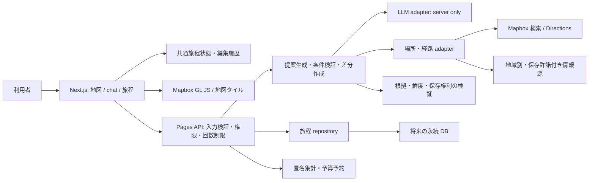

# CoVoyager Travel Chat — 全体設計

更新: 2026-10-14。状態: 設計案。基準 commit: `80556a15d6ee1e2ea8f329180756a9592e7723d9`。
API、DB、制御、数値目標は未実装。[ロードマップ](ROADMAP.md)と合わせて読む。

## 1. 目的と現状

国内・海外旅行で、地図とチャットの提案を結び、利用者が順序・時刻・滞在時間を編集できる旅程を作る。目的地、日付、興味、移動手段、予算から候補を作り、位置と移動負荷を見て選択する。予約・決済は扱わない。

| 現状 | 確認できた実装 | 不足・制約 |
| --- | --- | --- |
| `pages/index.jsx` | Mapbox GL JS 地図とチャットの横並び、世界表示 | 地図破棄、選択連動、経路、旅程なし |
| `components/Chat.tsx` | completion API へブラウザから直接送信、応答表示 | 会話履歴送信・構造化出力・検証・server 境界なし |
| `components/TravelForm.tsx` | 空コンポーネント、フォームはコメント | 旅行条件入力なし |
| `pages/api/generatePlan.ts` | named export の関数 | Pages API の default handler ではなく chat から未接続 |
| `package.json` | Next `^12.0.0`、React `^17.0.2`、Mapbox GL `^2.15.0`、OpenAI `^3.3.0` | 依存更新と現行 API 互換性の確認が必要、test suite なし |
| Git 管理 | main と過去履歴、dependabot 設定ファイル | 環境ファイル・`.next`・`node_modules` が追跡済み。dependabot ecosystem が空 |

Azure、DB、認証、共同編集、天候・イベントのライブ取得はソースにない。README の将来機能の断定を修正した。旧 completion モデルを動作の前提にしない（[OpenAI 廃止履歴](https://developers.openai.com/api/docs/deprecations)）。

## 2. 設計方針と体験

- 現在の Next.js Pages Router を起点に単一アプリ＋server API。全面的な framework 移行は避け、サポートされた依存への更新を Phase 1 準備で評価する。
- 地図・旅程リスト・chat が `placeId` / `stopId` / `revision` を共有。提案は下書きで、利用者の「適用」で反映。地図クリックでカード選択、カード選択で地図移動。chat ごとに Map を作り直さない。
- モバイルは地図/旅程切替、キーボードで候補選択・並べ替え、地図不可でもテキスト旅程で継続。地図 CSS、load/error、unmount cleanup を実装する。
- 国コード、表示言語、現地 IANA time zone、ISO 日付、通貨コードを分離。UTC instant と現地 wall time を保持し、夏時間・日付変更線・複数都市を検証。検索言語と対応地域を混同しない。
- 暫定規模: 100 日次利用者、1 人 10 chat/日、1 旅程 7 日・1 日 8 訪問先。負荷・費用試算の仮定で、利用実績ではない。入力上限は API で明示する。
- 暫定目標: 端末内編集 200 ms、chat 状態表示 1 秒、chat 処理 30 秒打切り、外部検索 8 秒 timeout。利用実測で改訂し、MVP で SLA を保証しない。

## 3. 構成図と責務



Phase 1 標準案は単独利用・端末内旅程保存と JSON export/import。DB は repository interface の将来実装で、今回導入しない。chat 本文はメモリのみを初期値とし、保存は別の明示操作。共有・端末間同期は Phase 2 の権限設計後。端末保存は暗号化を保証しないため機微情報を扱わず、「全削除」と export の注意表示が必要。

server は外部通信の境界。LLM は候補と型付き変更案を作り、座標・実在・営業時間・経路を確定しない。許可した tool の結果を参照し、schema、日付、座標範囲、参照 ID を検証。HTML、任意 URL fetch、SQL、予約実行を許さない。正本は利用者が適用した revision。生成器と決定的検証器を分け、LLM の説明を事実と扱わない。

同期 API から開始。永続 queue や microservice は初期には不要。Phase 3 の長時間再計画で必要なら期限付き job と取消を追加。DB 導入時はトランザクション・外部キー・revision 比較更新を評価するが製品選定は未決。

### データフロー

1. 旅行条件、選択 ID、viewport、必要な旅程要約だけを送信。無関係な履歴や個人情報を送らない。
2. server が入力・容量・予算を検証して検索/経路を取得。地域未対応は手動入力や正規の別情報源へ誘導。
3. LLM の型付き候補を検証し、根拠と不明項目付き `Proposal` を返す。未知の場所を確定ピンにしない。
4. 候補ピンと変更差分を表示し、利用者が追加/却下/編集する。
5. 適用は revision 比較。競合なら正本再取得と再提示。手動編集を消さず、取消で前 revision に戻す。

## 4. Mapbox と地域別情報

2026-10-14 に公式資料を確認。実装前に再確認する。現在の v2 試作を今回最新へ上げてはいない。

| 領域 | 公式仕様・制約 | 設計への反映 |
| --- | --- | --- |
| 描画 | [GL JS](https://docs.mapbox.com/mapbox-gl-js/guides/) は browser で地図や独自データを描画 | 旅程を GeoJSON source/layer に投影 |
| 地点検索 | [Geocoding v6](https://docs.mapbox.com/api/search/geocoding/) に POI データなし | 住所/都市解決と観光施設探索を分離 |
| POI | [Search Box 対応地域](https://docs.mapbox.com/api/search/search-box/#supported-geographies) は米国・カナダ・欧州 | 日本や他地域は別 provider または手動入力。日本語対応を日本対応と解釈しない |
| 保存 | [Geocoding 保存条件](https://docs.mapbox.com/api/search/geocoding/#storing-geocoding-results): temporary は cache 不可、permanent は保存可能でカード登録等の条件あり | temporary の結果・派生座標を DB/localStorage/export/log へ保存しない |
| POI 保存 | [Search Box 制限](https://docs.mapbox.com/api/search/search-box/#search-box-api-restrictions-and-limits) は一時利用のみ、位置保存は sales へ相談 | 無許諾で永続旅程に複写しない。feature ID だけならよいとも仮定しない |
| 経路 | [Directions](https://docs.mapbox.com/api/navigation/directions/) は driving/driving-traffic/walking/cycling、2〜25 座標 | 1 日単位で分割。鉄道・バス・航空・船は別扱いで未計算。直線を移動経路と呼ばない |
| 交通 | Directions の交通は対応地域の道路データ | 観光混雑人数、暑さ、施設適合性へ転用しない |
| 権利表示 | [Attribution](https://docs.mapbox.com/help/dive-deeper/attribution/) | Mapbox/提供者表記を保持し、狭い画面でも確認可能に |
| token | [Tokens API](https://docs.mapbox.com/api/accounts/tokens/) | browser public token は最小 scope・URL 制限、server secret と分離 |

保存可能な地理情報の取得先選定が P1 の最優先 gate。無課金レビューは架空 fixture と独立した手動入力。API 結果を見て転記すれば独立入力になる扱いはしない。国内・海外各 1 都市で住所・施設・経路・言語を検証し対応地域表を公開。全世界の POI、交通、営業情報の完全性を保証しない。

## 5. 論理データモデル

P1 は JSON で同じ関係を表し、将来 DB へ移す。ID は opaque UUID、参照整合性は API で検証。

| Entity | 主な field / 関係 | Phase / 可視性 |
| --- | --- | --- |
| Trip | id, ownerId?, title, locale, countryCodes[], dates, defaultTimeZone, budgetMoney, schemaVersion, revision | P1 端末内、owner は共有時追加 |
| Day | id, tripId, localDate, timeZone, stopIds[] | P1、Trip 配下 |
| Place | id, userLabel, coordinates?, countryCode, provider?, providerRef?, evidenceIds[], storageRights | P1、longitude/latitude 順、保存可能な値のみ |
| Stop | id, dayId, placeId?, kind(visit/rest/transfer), startLocal, startInstant?, durationMinutes, locked, participantIds[], note? | P1、時刻未確定 nullable。参加者割当は P2 |
| Leg | id, fromStopId, toStopId, mode, distanceMeters?, durationSeconds?, geometry?, evidenceIds[], status | P1、保存権利適用、未計算可 |
| Evidence | id, sourceUrl?, provider, retrievedAt, validForDate?, expiresAt?, confidence, uncertainty[], storageRights | P1、provenance 自体の保存権利も確認 |
| Proposal | id, tripId, baseRevision, patch[], rationale, warnings[], evidenceIds[], status | P1、draft/applied/rejected/expired |
| ChatMessage | id, tripId, role, text, proposalId?, visibility, createdAt, expiresAt | P1 揮発、本文 log なし |
| Membership | tripId, participantId, role(owner/editor/viewer), status | P2、招待を本人が受諾 |
| Constraint | id, ownerParticipantId, tripId, kind, strength(required/preferred), value, visibility(private/shared), version | P2、本人所有、明示共有だけ合意画面へ |
| Agreement | id, proposalId, affectedParticipantIds[], requiredVotes[], votes[], conditionVersions, decidedAt? | P2、未回答/棄権は同意ではない |
| PrivateAccommodation | id, ownerParticipantId, purpose, minimizedRule, encryptedPayload?, consentId, retentionUntil | P3、共有表と別 repository/鍵、本人のみ |
| Consent | id, subjectId, purpose, fields[], recipients[], processor?, policyVersion, grantedAt, expiresAt, revokedAt | P3、目的・提供先ごとに分離 |

Money は integer minorUnits＋ISO 通貨。為替には source・取得時刻・推定幅を付け、予約価格と区別。別室は旅行上の宿泊割当条件で、理由や関係性を推測・保存しない。

temporary の Place/Leg は session 表示領域のみ、永続 Trip に外部結果を含めない。export は schemaVersion と保存可能 field の allowlist。import は schema・参照・容量を検証し命令として扱わない。

P2 DB の関係は Trip→Day→Stop、Trip→Membership、本人→Constraint。比較更新と外部キー、(tripId, localDate)/(tripId, participantId) 一意性。監査は actor/action/resource/time の最小 metadata とし原文を保存しない。

## 6. API 契約案（未実装）

P1 は端末内 repository CRUD＋stateless server API。共有 CRUD は P2、認証方式は別途決定。既存 generatePlan はこの契約に非対応。

| API | request → response | 境界 |
| --- | --- | --- |
| POST `/api/chat` | message, context{tripSummary, selectedPlaceId?, viewport?}, baseRevision → reply, proposal?, warnings, evidence | 本文最大 4,000 文字、context 32 KiB、提案のみ |
| POST `/api/places/search` | query, country, language, bbox?, searchSessionId? → candidates, coverage, storageRights | 最大 10 候補、地域別 adapter。Search Box token は並行 session ごとに別値 |
| POST `/api/routes` | orderedCoordinates, mode, localDate → legs, warnings, evidence | 2〜25 座標、未対応 mode/地域明示 |
| POST `/api/proposals/validate` | proposal, currentRevision, itinerary → violations[], costEstimate, validatedPatch | 決定的検証。承認は代行しない |
| POST `/api/trips`; GET/PATCH/DELETE `/api/trips/:id` | schemaVersion, JSON / If-Match revision → revision | P2、各操作で membership 検証、子データも削除 |
| POST `/api/trips/:id/proposals/:proposalId/apply` | baseRevision, idempotencyKey → newRevision | P2、合意済み条件 version と票を transaction で確認 |
| PUT `/api/trips/:id/constraints/:id` | strength, rule, visibility → version | P2、本人のみ変更、private 初期値 |
| POST `/api/trips/:id/agreements/:id/votes` | accept/reject, conditionVersion → state | P2、本人の票のみ。条件変更で再同意 |
| POST/DELETE `/api/me/consents/:id` | purpose/fields/recipients/expiry または撤回 → state | P3、本人のみ、第三者は付与不可 |
| POST `/api/trips/:id/replans` | revision, disruption, lockedStopIds → alternatives[] | P3、差分確認、自動適用/購入なし |

架空の入力例（保存可能な手動入力の旅程を前提）:

```json
{
  "baseRevision": 3,
  "message": "午後の訪問を一つ減らして休憩を追加したい",
  "context": { "tripSummary": { "id": "fictional-trip", "locale": "ja-JP" } }
}
```

400 schema 不正、401/403 共有時の権限、409 revision/同意 version 競合、422 条件衝突/未対応 mode、429 回数上限、503 provider 不可/費用上限。共通 `error{code,message,retryable,requestId}`。生レスポンス・キー・内部 stack を返さない。timeout は未確定で終了し手動編集を維持。retry は読取り相当で最大 1 回、backoff と Retry-After。LLM の不明な実行結果は自動再送しない。P2 更新は idempotencyKey＋revision で重複適用を防ぐ。

P1 は匿名でも server 回数制限を必須とし、公開前に abuse 対策を評価。匿名 server に旅程全文を永続化しない。

## 7. 根拠・鮮度・不確実性

カードは出典、取得日時、対象日、確認済み/推定/未確認、次の確認を表示。LLM 知識のみなら未確認とし、座標・営業を確定しない。取得時刻を情報更新時刻と呼ばない。

| 情報 | 暫定再確認方針 | 不明時 |
| --- | --- | --- |
| 地点/住所 | 旅行前・情報源更新時、保存可否は別 gate | 同名候補選択、未確認ピン非確定 |
| 営業/料金 | 計画時＋訪問前 24 時間、施設公式優先 | 営業/予約可と断定せず確認リンク |
| 道路移動 | 日時/経由点変更、現地再計画 | 推定幅、手段未対応表示 |
| 天候/暑さ | P2 将来 adapter、予報対象日/発行時刻、暫定 1 時間で再確認 | 予報なしを推測で埋めず屋内/休息候補 |
| 観光混雑 | P2、実測/予測/経験則を区別、暫定 1 時間 | 道路渋滞を転用せず不明表示 |
| 為替/概算 | 見積時と決定前、暫定 24 時間 | 元通貨保持、上限との差を不確実性付きで提示 |

再確認目安は cache 許可ではない。非保存 provider は TTL 内でも永続化しない。より短い利用期限に従う。出典不一致は両案を示す。到着時刻の保証や災害/健康の安全判定は行わない。

## 8. セキュリティとプライバシー

現状の `NEXT_PUBLIC_OPENAI_API_KEY` 参照は browser 露出可能性がある。[Next.js 公開変数](https://nextjs.org/docs/pages/guides/environment-variables)仕様に従い P1 で server secret に置換。2026-10-14 の追加対処で、旧 OpenAI キーは本人申告で失効済みとして扱い、`.env.local` と `.next` を現行 Git ツリーから除去した。失効を API で検証したわけではない。過去履歴とローカルの非公開復元用コピーは保持し、履歴書換え・キー発行/失効・認証変更は行っていない。空の `.env.example` と `.gitignore` で再混入を防ぐが、明示的な force add を防ぐ保証ではない。legacy browser 変数へ新しい秘密を入れず、server 移行を別実装とする。上の現状表は変更前基準 commit の調査結果で、`node_modules` の既存追跡は今回の除去対象外。

- 秘密・実チャット・個人の健康/交際情報を Git、公開 issue、fixture、画像、解析 log に入れない。公開例は架空。公開文書に利用者/同行者の事情を含めない。
- 健康関連配慮は P3 まで収集しない。P2 は旅行上の徒歩上限/休息頻度などを任意入力、診断や理由を求めず推測しない。
- P3 は本人が項目・目的・保存期限・外部提供先を確認して同意。拒否しても通常計画可能。機微原文を LLM に送らず、本人が承認した最小抽象ルールを基本にする。外部提供は別同意。
- PrivateAccommodation は同行者・Trip owner にも非公開。共有 DTO、検索、log、export、履歴、cache から除外。本人認可＋同意有効性を毎回検証し、暗号化/鍵管理を分離。
- 非公開条件で公開案が変わると理由が推測されうる。説明は一般化し条件所有者を出さない。派生ルールを共有するにも本人の確認。理由推測を完全に防ぐ保証はせず、共有前に説明する。
- 撤回時は新規処理即停止、active データと未適用提案を無効化/削除。暫定保持: private は旅行終了＋7 日、監査 metadata 30 日、backup 最大 30 日。法的/運用評価後に確定。相手のコピー回収は保証できないことを共有前に示す。
- [LLM データ管理](https://developers.openai.com/api/docs/guides/your-data)は契約/endpoint 単位で確認。学習利用と保持・log を混同しない。ゼロ保持を無条件宣言しない。地域/委託先/保存期間未決なら P3 を開始しない。
- P2 の認証方式決定後に membership server 認可、招待期限/失効、CSRF 対策、cookie の secure/HttpOnly 等を実装。今回認証方式は変えない。
- 外部資料/import の prompt injection はデータ扱い。URL allowlist、SSRF、出力 escape、schema allowlist、body size、CORS/CSP を実装。入力を popup HTML へ直接渡さない。
- 地理 API へ健康情報や chat 本文を送らない。現在地は任意、継続追跡なし。public 共有リンクは MVP 非対象。
- 診断・治療・適性判定・安全保証は行わない。施設情報は公式窓口で本人が確認する。

## 9. 費用上限と運用

今回、有料 API を呼ばず新規課金を有効にしない。運用予算は所有者承認まで `0`。以下は未実装の暫定方針。

- [Mapbox pricing](https://www.mapbox.com/pricing) の map loads、検索 session/request、Directions の単位を区別。単価・無料枠は確認日付き契約表で管理。LLM は採用モデルの input/output 単価で計算。
- 月額 B/日次 D を決め API ごとに配分。呼出前に最大推定費用を原子的に予約し実績精算。並行 request の残額競合を防ぐ。単価/利用量不明なら停止。
- 50%/80%で通知、100%で有料処理停止。手動編集/export は維持。無料枠超過を自動購入で解消せず、provider 通知を hard cap と扱わない。
- 暫定 session guard: chat 20/日、search 100/日、route 30/日、出力最大 2,000 tokens、tool 最大 3/turn。規模仮定では約 30,000 LLM turn/月。個別制限に加え全体上限を持ち実測改訂。
- 検索は 3 文字・300 ms debounce と session、route は旅程変更時のみ。cache は許可された field だけ。
- browser public token の map loads は server 予算 guard だけで完全停止できない。URL 制限、地図初期化 gate、token 停止手順、provider 利用監視が必要。厳密な総額保証が必要なら契約上の停止手段を確認するまで公開しない。
- 件数/status/latency/推定費用/coverage を匿名集計。原文・個人条件・精密位置履歴を log しない。provider 障害時は circuit breaker と手動編集。計測後に増強する。

## 10. テストとリリース gate

今回は名称と文書のみ。実 API の機能テストは未実施。将来必須の検証:

| 層 | シナリオ |
| --- | --- |
| Unit | schema、minorUnits、座標順、DST/日付変更線、順序・休息・必須条件、revision、期限切れ根拠 |
| Contract | 地域/mode 未対応、不正 JSON、no route、429/timeout、検索 session、temporary 非保存、許諾判定 |
| UI/E2E | 国内/海外架空 fixture、地図↔chat↔旅程、適用/取消、手動編集保全、refresh/import、キーボード/モバイル/地図不可 |
| Security | secret の bundle 非混入、SSRF/XSS/injection、IDOR、owner も他人 private を読めない、export/log の漏えいなし |
| P2/P3 | 必須条件衝突、未回答票、条件変更の再同意、休息/別行動合流、撤回直後の API/再計画停止、派生説明の漏えい |
| Cost/resilience | 並行残額要求、100%停止、未知費用、outage、重複送信、不明結果の再送防止 |

CI は架空 fixture と mock、外部 API なし。live 検証は別途承認された予算・保存条件・非機微データで実施。依存脆弱性検査と secret なし build の gate を閉じてから公開。現状に test suite があると見せない。

## 11. 移行と名称変更

表示名 **CoVoyager Travel Chat**、slug **covoyager-travel-chat**。GitHub 自体を rename し履歴再作成なし。README clone URL、package name/repository/homepage、lock root name、見出しを更新。依存 subtree、LICENSE、旧生成物を名称だけのために編集しない。

[GitHub rename](https://docs.github.com/en/repositories/creating-and-managing-repositories/renaming-a-repository)は通常の URL/Git を転送するが旧名再利用で壊れる。Actions の `uses: owner/old-repo@ref` は転送されない。Pages、外部 webhook/CI/hosting、local remote は別途点検。ダッシュボードは別担当で、今回は操作しない。

1. 今回: baseline 調査、最小改名差分、文書、公開前点検、main に追加 commit。force push/history rewrite なし。
2. P1 準備: キー失効判断と生成物追跡解除は別変更。依存/API handler/server LLM を更新し mock 検証。履歴除去は別途明示承認が必要。
3. P1: schemaVersion=1、repository interface、手動編集、提案検証。地理保存許諾決定までは fixture/manual mode。
4. P2: 招待/権限/DB。JSON の明示 import、ローカルを無断 upload しない。revision を保持。
5. P3: consent/private storage gate 後に段階公開。rollback は収集停止→アクセス停止→削除 job。通常旅程を破壊しない。

コード rollback は revert commit。名称を戻す場合は外部リンク影響を管理者が判断。失効キーを rollback で復活させない。

## 12. 未決事項とトレードオフ

- 国内/海外の保存許諾付き POI provider、Mapbox permanent の契約条件/費用。未決なら live 永続旅程を開始しない。
- LLM provider/API/model、Azure 採否、地域、保持契約。旧 README の Azure を採用決定と扱わない。
- 対応都市/交通手段、宿泊/営業/天候/混雑 provider と品質。手動入力は広く使えるが検証済み情報範囲は限られる。
- P2 認証/DB/招待と合意ルール。影響者全員同意を初期値とし、少数決は決定まで採らない。
- B/D の具体額、browser map load 停止、運用担当/通知先。未決で課金開始しない。
- P3 の同意文面/保持/削除/法的評価/外部提供。収集を増やす前に決定。
- リアルタイム共同編集、offline map、予約、public 共有、専用 solver は後続判断。単一 API＋revision は低コストだが大規模共同編集に限界。

これらは設計と実装を区別するための未決事項で、導入・契約の実行記録ではない。
